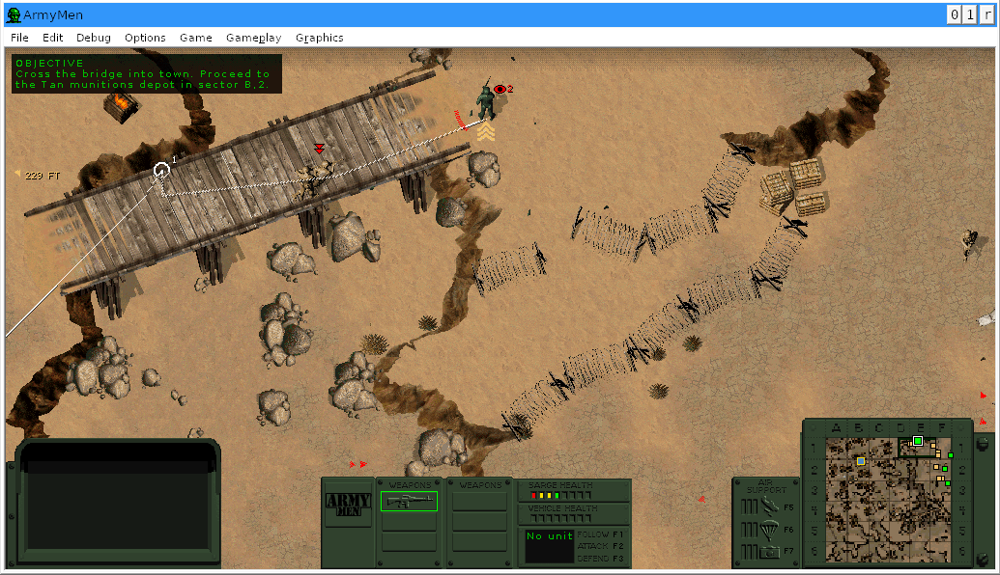
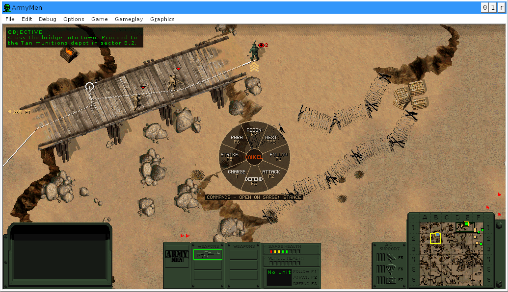
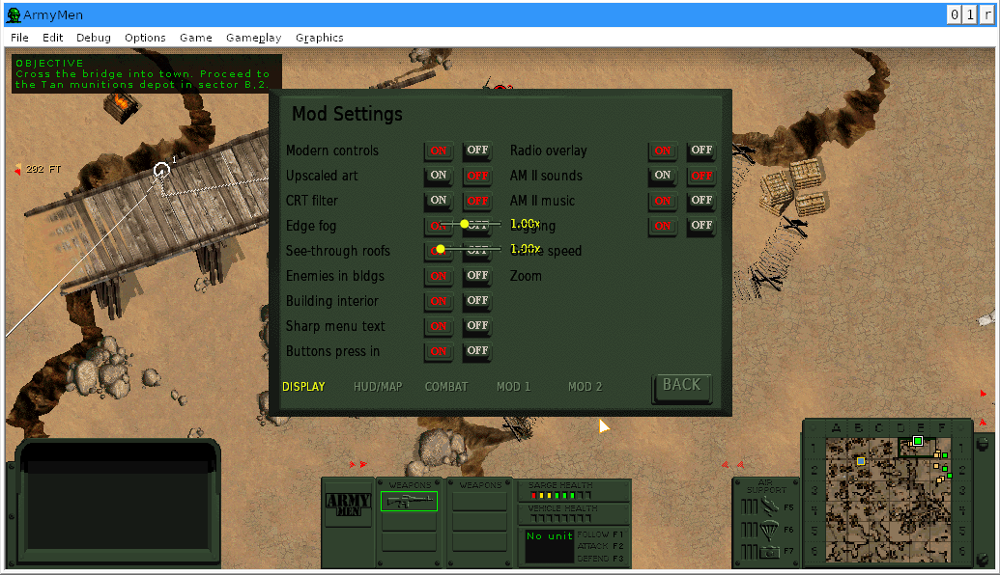

# Army Men Modern

Army Men Modern updates the original 1998 PC game for current systems while preserving its campaign, missions and
art style.

> **Bring your own game:** this repository and its releases contain no Army Men assets or executables. All screenshots
> below use the original Army Men artwork (`hd_world=0`, `hd_sprites=0`).


*Extended widescreen battlefield, sliced/scaled HUD groups, six-slot weapon panel, pinned objective, mission route, enemy awareness marks, and enlarged minimap.*

Highlights include true widescreen and ultrawide play, modern mouse/WASD controls, a scalable HUD, improved minimap,
mission-route guidance, expanded weapons and equipment, squad and vehicle improvements, enemy awareness, optional
Army Men II audio and extensive stability fixes.

## Install

The release is one file: `ddraw.dll` (download from [Releases](../../releases)).

1. Use the GOG release of Army Men (1998).
2. Place `ddraw.dll` beside `Armymen.exe`.
3. Start the game normally.

The original executable is not modified. The DLL applies the mod in memory when the game starts. An INI, manifest
and HD-art pack are not required.

For Proton/Bazzite, add this launch option:

```text
WINEDLLOVERRIDES="ddraw=n,b" %command%
```

## Screenshots

| Command & stance radial | In-game Mod Settings (fully configurable) |
|---|---|
|  |  |

**[See more screenshots →](docs/SCREENSHOTS.md)** (minimap & route guidance, equipment & combat overlays, vehicle interaction, and the optional classic centered-HUD preset).

## Options

Use **Mod Settings** in the main/pause menu or the `F10` interface (`Shift+F10` for the compact overlay and binding
editor). Settings changed in game are saved to `armymen-mod.ini`; advanced users may also copy the documented example
[src/armymen-mod.ini](src/armymen-mod.ini) beside the DLL.

- **Classic gameplay** turns off gameplay, control and tactical additions while retaining the modern renderer.
- **Modern HUD layout** controls the sliced/scaled widescreen HUD. Turn it off for the original centered 1× HUD.
- **Logging** writes `armymen-mod.log` beside the DLL for tester reports. The previous run is retained as
  `armymen-mod.prev.log`.
- **Session recording** is on by default in release builds and can be turned off in `armymen-mod.ini` with
  `[debug] record_runs=0` (`Ctrl+Shift+B` drops a bookmark; see [scripts/rec2test.py](scripts/rec2test.py)).
- **Built-in updater** checks GitHub Releases on startup (can be toggled in **Gameplay > Check for updates at start**
  or `[update] check=0` in `armymen-mod.ini`), verifies `ddraw.dll.sha256`, swaps `ddraw.dll` in place, and restarts
  the game.

## Optional Army Men II music and sounds

The mod can play Army Men II music and sound effects instead of the originals. The packs are not included; drop
the `am2_music` and `am2_sounds` folders beside `Armymen.exe`:

```text
<game folder>\
  Armymen.exe
  ddraw.dll
  am2_music\    map.txt + title.wav, bootcamp.wav, ...
  am2_sounds\   map.txt + the effect .wav files
```

Turn them on in **Mod Settings > Audio**, in the `F10` panel ("Army Men II music" / "Army Men II sounds"), or in
`armymen-mod.ini` under `[audio]` with `am2_music=1` / `am2_sounds=1`. Each `map.txt` decides which file replaces
which track or sound; without it the original audio plays (the log says so).

`am2_music\map.txt` - `<AM1 stream id> <missions> <file>`; the first matching line wins, no line = the original
track. Missions: `*` (any) or a list like `1-3,8` (Desert 1-9, Alpine 10-18, Bayou 19-28, Boot Camp 50):

```text
2000 *      title.wav      # TITLE_MUSIC - title / main menus
2001 50     bootcamp.wav   # ALPINE1_MUSIC - Boot Camp
2001 10-11  homeland.wav   # ALPINE1_MUSIC - Alpine scenario 1
2001 *      homeland.wav   # ALPINE1_MUSIC - Alpine campaign map screen
2002 *      igd.wav        # ALPINE2_MUSIC - Alpine high intensity
2003 1-3    areax.wav      # DESERT1_MUSIC - Desert scenario 1
2004 *      fortress.wav   # DESERT2_MUSIC - Desert high intensity
2005 19-20  kitchen.wav    # BAYOU1_MUSIC - Bayou scenario 1
```

Stream ids: 2000 title, 2001/2002 Alpine low/high, 2003/2004 Desert low/high, 2005-2007 Bayou, 2008 win, 2009 lose.

`am2_sounds\map.txt` - `<AM1 sound id> <file>` (any RIFF PCM wav); a sound without a line keeps the original:

```text
1001 1001_explosionmortar.wav   # MORTAR_EXPLODE
1002 1002_explosiongrenade.wav  # GRENADE_EXPLODE
1004 1004_explosionm80.wav      # BIG_EXPLOSION - air strikes, destroyed vehicles
```

## More information

- [Full mod description](docs/MOD_DESCRIPTION.md)
- [Screenshot gallery](docs/SCREENSHOTS.md)
- [Release notes](docs/release-notes/v0.1.1.md)

## License

Code: [MIT](LICENSE).

Not affiliated with or endorsed by The 3DO Company, 2K, or GOG. Army Men is a trademark of its respective owner.
