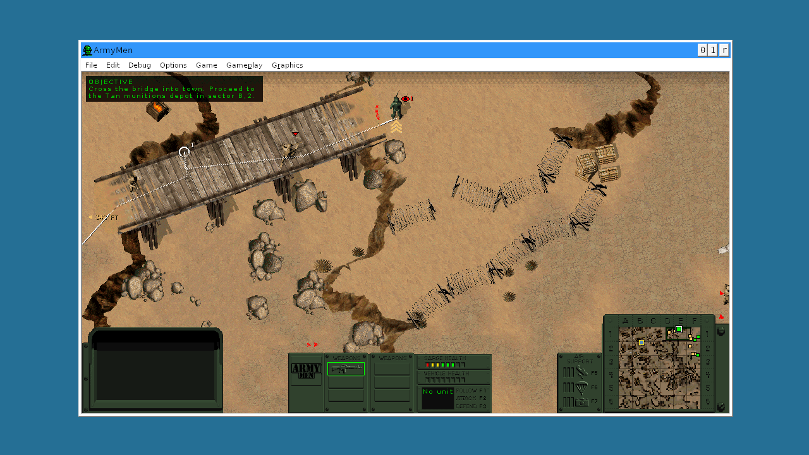
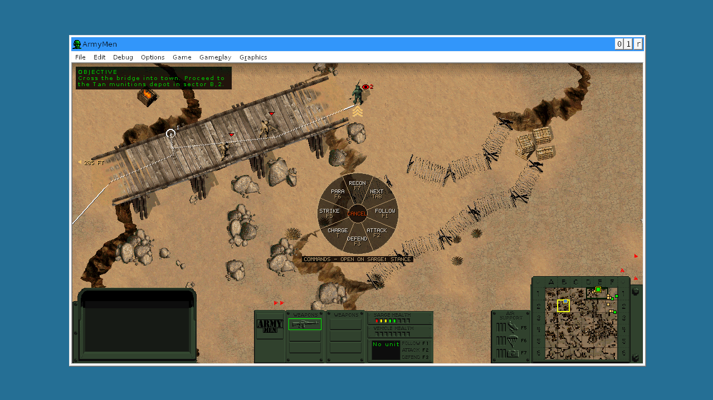

# Army Men Modern Mod

Army Men Modern is a drop-in modernization mod for the original 1998 PC game. It keeps the campaign, missions,
art direction and core tactical action intact while making the game comfortable on current Windows systems and
modern displays. It adds widescreen rendering, mouse-driven controls, clearer tactical feedback, expanded squad
and vehicle systems, optional Army Men II audio, and a large collection of gameplay and
stability improvements.

The mod runs through a replacement `ddraw.dll`; the original `Armymen.exe` remains unmodified. Most additions can
be changed while playing through **Mod Settings** or the F10 panel, and nearly every gameplay feature can be
disabled independently.

The release can be distributed as one `ddraw.dll`. It has built-in defaults, sets its own DPI awareness and does
not require an INI, manifest or HD-art folder. Diagnostic logging is available for tester reports.

## Original-art screenshots

These screenshots were captured at 1024x540 with `hd_world=0` and `hd_sprites=0`. They show the original game art,
not the optional HD battlefield or sprite pack.

### Widescreen gameplay and redesigned HUD



The battlefield extends into the extra screen space instead of stretching a 640x480 image. The objective is pinned
at the upper left, the HUD groups are separated and scalable, the minimap is enlarged, and the current mission route
is drawn directly across the world.

### Mouse-driven command wheel



The radial menu exposes squad orders and air support without removing the original hotkeys. Opening it on Sarge
instead presents the stance controls.

## Modern display support

- Native windowed and borderless-fullscreen play at common resolutions from 720p through 4K, plus custom sizes.
- True widescreen and ultrawide views that reveal more battlefield instead of stretching the original picture.
- Resizable windows, whole-number scaling, monitor-refresh synchronization, and correct speed at 60, 120, 144 Hz
  and other refresh rates.
- GPU presentation through Direct3D 11, with selectable sharp, lightly smoothed or fully smoothed scaling.
- Optional battlefield zoom that enlarges the world while leaving the HUD at a readable size.
- Optional CRT filter, fitted video playback, map-edge fog and blurred menu backgrounds.
- Correct DPI behavior, Alt+Enter/F11 fullscreen switching and reliable Alt-Tab/window focus handling.
- Resolution-independent menus, HUD drawing, cursor placement, minimap interaction and mouse hit-testing.
- Sharper menu labels and radio text rendered at the output resolution.
- Improved drawing order for soldiers in front of buildings, openings in damaged roofs, helicopters and other airborne
  objects. Sarge can optionally remain visible through tall scenery.
- Optional HD world, sprite, HUD, menu and video packs are supported, but are not required.

## Modern controls

- Point-and-click movement with pathfinding: click to walk, double-click to sprint and hold to steer continuously.
- Mouse aiming and context-sensitive left click for moving, firing, entering vehicles, selecting units and using
  objects; right click provides force-fire behavior.
- WASD movement in screen directions, smooth camera follow and configurable camera lead.
- Modern stance controls: click, double-click or drag on Sarge; hold/double-tap the stance key; or use the stance
  wheel.
- Mouse wheel weapon selection, quick swap, six numbered weapon slots and clickable HUD weapon boxes.
- Fully configurable modern bindings for movement, stances, weapons, squad actions, map, objectives, radial menu,
  vehicle use, healing, restart and utility actions, including extra mouse buttons and tap/hold/double gestures.
- In-game binding editor with conflict swapping and reset-to-default support.
- Grenade and mortar aiming keeps the intended target under the pointer, adds a delayed long-range camera view and
  displays the blast area.
- Input-aware prompts and clearer feedback for blocked shots, range, cover and special actions.

## Expanded HUD and tactical information

- Modular HUD layout with scalable message, weapon, health, squad, air-support and minimap groups.
- Large scalable minimap with higher-contrast terrain, outlined army-colored blips and a highlighted Sarge marker.
- Hover tooltips identify a blip's army, unit or vehicle type, soldiers remaining, health and distance.
- Mission objectives remain visible at the top of the screen; relevant minimap sectors blink.
- A route line guides Sarge through the current mission objective. It advances as objectives are completed, supports
  walking and vehicle routes, understands mission pads and escorted vehicles, and can add bounded route variation.
- Enemy awareness indicators show who could see Sarge, who has noticed him, who lost him and who is actively
  targeting him.
- Optional enemy class labels, ally and vehicle health bars, weapon-range warnings, blast circles, mine markers,
  healing cursors and contextual tooltips.
- Redesigned command radial for squad orders, air strikes, paratroopers and reconnaissance.
- Attack and Defend enter a target-picking mode; commands can target the battlefield or anywhere on the minimap.

## Weapons and equipment

- Six carried weapon positions instead of the original three. Duplicate pickups add ammunition, and weapons can
  stack up to 99 rounds or charges.
- Weapons carry into later parts of the same scenario, including their ammunition and placed-charge records; Play
  Again restores the weapons present at that part's start.
- Non-rifle enemy specialists can drop their weapon as a real pickup crate when killed.
- Mine placement at the pointer with placement previews and explanations when a tile is invalid. Distant placement
  can combine walking with laying the mine.
- Reworked minesweeper: passive nearby detection, visual and audio proximity feedback, safe revealed mines, and
  click-to-walk-and-collect disarming.
- Medkits found at full health can be carried, shown in the HUD and used on Sarge or friendly soldiers.
- Clearer ammunition counts, unlimited-ammo display, active-slot highlights and medkit/minesweeper HUD states.

## Squad improvements

- Player soldiers can have increased maximum health, regenerate after avoiding damage and display health bars when
  wounded.
- Following soldiers sprint with Sarge and accelerate when needed to catch up without passing through obstacles.
- Carried medkits can heal friendly troops; Alpine medical tents heal the player's soldiers as well as Sarge.
- Attack and Defend orders allow precise target selection, with the nearest deployed squad selected when no squad is
  currently active.
- Enemy squads sent on one-way marches can patrol between their start and destination until combat interrupts them.
- Squad selection, order targeting and minimap labels have received numerous correctness and usability fixes.

## Smarter, fairer combat

- Configurable height-rule modes: streamlined modern rules, Army Men II-style projectile height, the original game's
  behavior, or the mod's earlier experimental behavior.
- Modern rules make direct fire hit the first valid unit crossed, account for standing/kneeling/prone damage and low
  cover, reduce prone visibility and reward attacks from behind.
- Shots interact with the actual occupied parts of buildings and cover instead of invisible roof-sized blockers;
  rifles can optionally fire over fences and low walls.
- Enemies must notice Sarge before firing. Detection takes longer at range and while kneeling or prone, but firing or
  attacking a unit alerts it immediately.
- Reticle feedback reports out-of-range targets, blocked fire and relevant cliff/ridge/height behavior.
- Sarge can regenerate health after a configurable delay.
- Collision, projectile, splash-damage, stance, low-cover and vehicle-on-hill behavior has been made consistent across
  player and AI weapons.

## Vehicles

- Click-to-drive routes use the vehicle's actual footprint and heading, with reversing, multi-point turns and a
  configurable preference for turning around instead of backing long distances.
- Smoother independent turret aiming keeps the gun pointed at the target while the hull turns.
- Vehicles can escape overlaps and no longer creep progressively into rocks, walls and sandbags.
- Sarge can enter empty enemy vehicles. They temporarily behave as player vehicles and return to their original army
  when abandoned.
- When enabled, a destroyed vehicle throws Sarge clear with damage and brief protection instead of killing him
  automatically.
- More reliable entering from the near side, crew detection, fire cursors, cannon blast indicators, vehicle health
  feedback and camera following—including helicopters.
- Vehicles retain their ability to crush breakable fences; optional on-foot fence breaking is also available.

## Configuration and accessibility

- In-game Mod Settings pages expose display, HUD, modern-control, combat, audio and minimap options.
- Nearly all additions are controlled through the documented `armymen-mod.ini` file.
- Adjustable game speed and pause hotkeys are available for accessibility, testing and relaxed play.
- Optional original-art CRT presentation and optional HD presentation can be selected independently.
- A **Classic gameplay** preset disables the gameplay, control, tactical-overlay, expanded-equipment, squad,
  vehicle and replacement-audio additions while retaining the modern renderer.
- A separate **Modern HUD layout** switch can be disabled to keep the original HUD centered at 1× size, including
  when the Classic gameplay preset is active.

## Audio options

- Optional Army Men II sound-effect pack for weapons, impacts, explosions, vehicles, aircraft and interface sounds.
- Optional Army Men II background-music pack with campaign-specific track mappings.
- Both systems fall back to the original Army Men assets when a replacement is absent and can be toggled in game.
- Original voices, mission radio, ambience and win/lose cues remain available as appropriate.

## Stability and compatibility work

- Replaces the obsolete exclusive 8-bit DirectDraw display path with a current Windows-compatible renderer.
- Fixes timing and game-speed problems on modern high-refresh and unpaced displays.
- Corrects cursor confinement, screen-edge movement, mouse scaling and coordinate errors at non-original resolutions.
- Prevents numerous crashes caused by stale mission objects, vehicle IDs, weapon records, pictures, sound sources and
  cross-mission rendering state.
- Fixes mission-restart, Play Again, later-scenario-part, captured-vehicle and map-transition failures.
- Corrects widescreen camera bounds, map-bottom gaps, HUD overlap, roof ordering, helicopter layering, Alpine palette
  text colors and objective wrapping.
- Includes safe fallbacks when GPU shaders or optional asset packs are unavailable.

## Installation

Place `ddraw.dll`, `Armymen.exe.manifest` and `armymen-mod.ini` beside the unmodified GOG release of
`Armymen.exe`. Optional HD, Army Men II sound and Army Men II music packs use their own folders and can be omitted.

On Proton/Bazzite, use:

```text
WINEDLLOVERRIDES="ddraw=n,b" %command%
```

