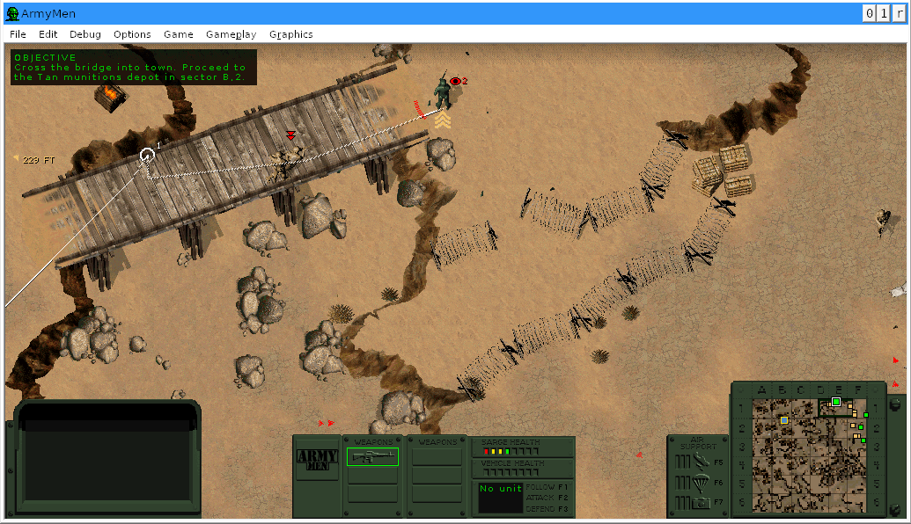
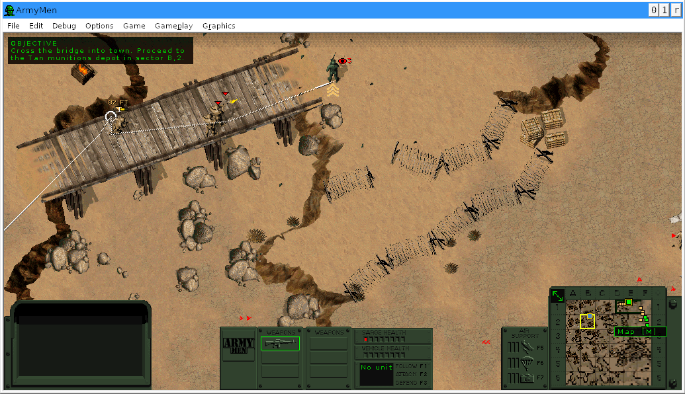
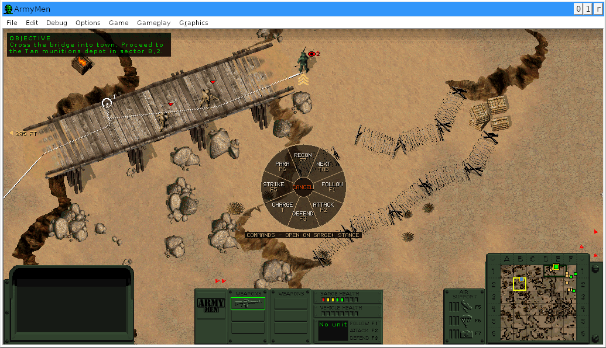
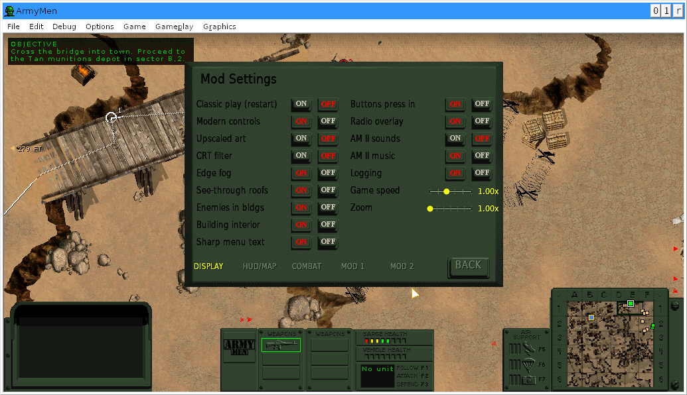
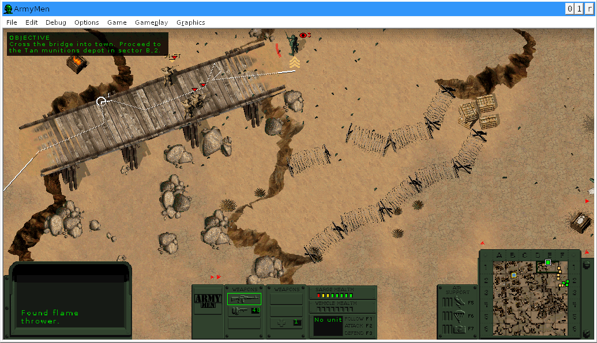
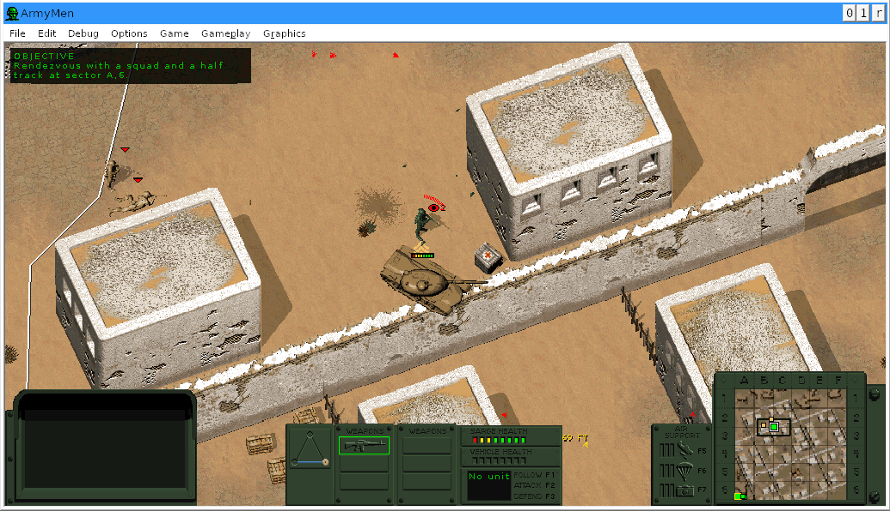
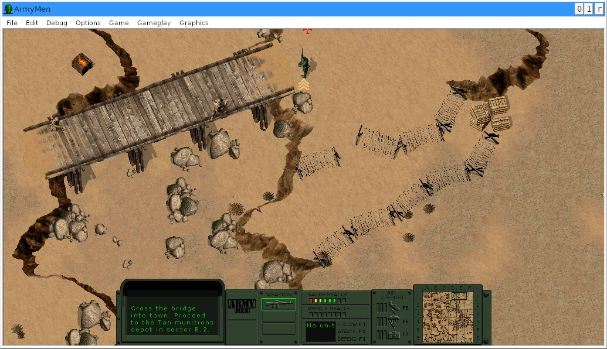

# Screenshots

All screenshots use the original Army Men world and sprite artwork (`hd_world=0`, `hd_sprites=0`) and are cropped
to the game window. Related visual features are grouped in the same image where possible.

## Widescreen battlefield and modern HUD

Shows the extended widescreen battlefield, sliced/scaled HUD groups, pinned objective, six-slot weapon panel,
mission route, target/distance feedback, off-screen indicators, enemy awareness marks and enlarged minimap.

## Minimap and route guidance

Shows the higher-contrast enlarged minimap, outlined army blips, marked Sarge position, mission target sector,
world-space route line and tactical alerts.

## Command radial

Shows the mouse-driven squad and air-support radial. Opening the radial over Sarge changes it to the stance wheel.

## In-game Mod Settings

Shows the configurable in-game Mod Settings menu with per-feature toggles, sliders for game speed and zoom,
diagnostic logging, and tabs for Display, HUD/Map, Combat, and Modern-control features—so every feature can be
enabled, tuned, or turned off without editing files.

## Equipment and combat overlays

Shows the expanded weapon HUD, carried-medkit indicator/count, weapon pickup notification, awareness/targeting marks,
health feedback, distance display, route line and off-screen arrows. Mine placement and minesweeper modes use the
same overlay system for placement rings, safe/blocked markers, mine pulses and proximity feedback.

## Vehicle interaction and route

Shows vehicle interaction, vehicle health, nearby-entry routing, mission guidance around buildings and the vehicle
on the tactical minimap. Driving additionally exposes click-to-drive routes, reversing/turning and turret aiming.

## Classic gameplay with original centered HUD

Shows the optional classic preset with modern gameplay/tactical additions disabled and the separate modern-HUD
layout option disabled. Widescreen rendering remains active while the original HUD stays centered at 1× scale.

## Features that do not have a meaningful still image

Audio replacement, persistent quicksave data, high-refresh timing, crash prevention, weapon carry-over between
missions, health regeneration, vehicle bail-out, collision recovery and AI behavior changes are behavioral features.
They are covered in the mod description rather than represented by misleading static screenshots.
